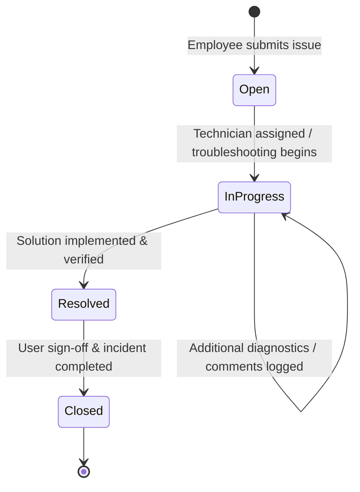
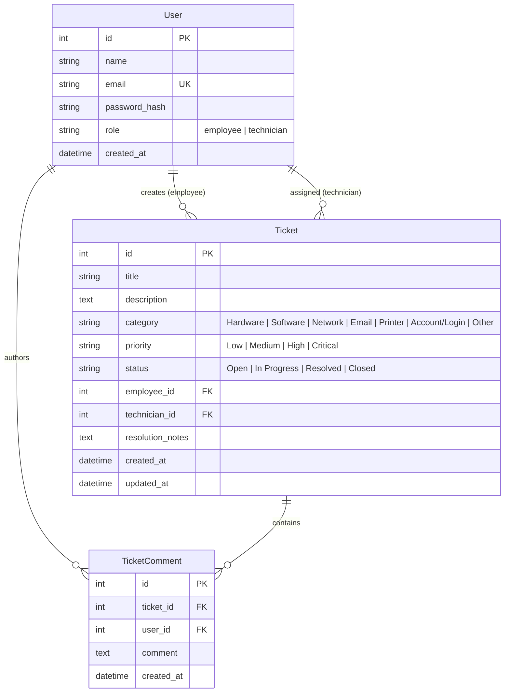

# IT Help Desk Ticket Management System

An enterprise-grade, beginner-friendly IT Help Desk and Incident Management System built with **Python Flask**, **Flask-SQLAlchemy**, **SQLite**, and **Bootstrap 5**. Designed specifically to showcase realistic technical support workflows, role-based access control, incident lifecycle management, and clean software architecture for IT Support, Desktop Support, and Technical Support Engineer roles.

---

## 📋 Table of Contents
- [Overview](#overview)
- [Key Features](#key-features)
- [User Roles & Permissions](#user-roles--permissions)
- [Ticket Lifecycle](#ticket-lifecycle)
- [Technology Stack](#technology-stack)
- [System Architecture](#system-architecture)
- [Database Design](#database-design)
- [Installation & Quick Start](#installation--quick-start)
- [Demo Credentials](#demo-credentials)
- [Running Automated Tests](#running-automated-tests)
- [Git & GitHub Setup](#git--github-setup)
- [Production Deployment](#production-deployment)
- [Future Enhancements](#future-enhancements)

---

## 🌟 Overview
In any corporate enterprise, employees encounter hardware malfunctions, software glitches, network connectivity loss, and account lockouts. The **IT Help Desk Ticket Management System** bridges communication between end-users and the IT support engineering team.

Employees can quickly submit detailed tickets with category and severity tags, while IT technicians leverage a dedicated operations console to triage, assign, investigate, document troubleshooting steps in an audit timeline, and record root cause resolutions.

---

## ✨ Key Features
- **Role-Based Access Control (RBAC)**: Strict segregation between Employee and Technician portals using custom Flask decorators.
- **Incident Lifecycle Tracking**: Realistic status transitions: `Open` &rarr; `In Progress` &rarr; `Resolved` &rarr; `Closed`.
- **Search & Compound Filtering**: Technicians can filter tickets across multiple parameters simultaneously (e.g. `Status=Open` AND `Priority=High` AND `Category=Network`) and search across Ticket ID, employee name, and keywords.
- **Chronological Troubleshooting Timeline**: Complete audit trail recording technician diagnostic notes, employee feedback, and automatic system action events.
- **Root Cause & Resolution Notes**: Dedicated capture of technical fixes (e.g., driver updates, cable replacements, Active Directory unlocks).
- **Responsive Corporate UI**: Clean Bootstrap 5 interface with distinct status/priority badges, SLA indicators, and one-click demo credentials auto-fill.
- **Enterprise Security**: Werkzeug password hashing (PBKDF2/SHA256), session hijacking defense, and strict access isolation (employees cannot inspect other employees' tickets).

---

## 👥 User Roles & Permissions

| Feature / Action | Standard Employee | IT Support Technician |
| :--- | :---: | :---: |
| Account Registration & Login | ✅ | ✅ |
| Submit Support Ticket | ✅ | ❌ (Employee Flow) |
| View Own Tickets & Status | ✅ | ✅ |
| View All Department Tickets | ❌ (Strict 403) | ✅ |
| Access Operations Dashboard | ❌ (Strict 403) | ✅ |
| Search & Multi-Filter Queue | ❌ | ✅ |
| Assign / Reassign Technician | ❌ | ✅ |
| Update Ticket Priority & Status | ❌ | ✅ |
| Add Troubleshooting / Audit Notes | ✅ (Reply Only) | ✅ (Full Notes) |
| Submit Resolution & Close Ticket | ❌ | ✅ |

---

## 🔄 Ticket Lifecycle



1. **Open**: The ticket has been created and is awaiting technician assignment and initial triage.
2. **In Progress**: An IT technician has picked up the issue, is investigating, and is logging troubleshooting steps.
3. **Resolved**: The root cause has been diagnosed and the fix has been implemented and validated.
4. **Closed**: The resolution has been acknowledged by the user, peripheral dispatched, or final sign-off completed.

---

## 🛠 Technology Stack

- **Backend**: Python 3.11+, Flask 3.x
- **ORM & Database**: Flask-SQLAlchemy 3.x, SQLite 3
- **Frontend**: HTML5, CSS3, JavaScript (ES6), Jinja2 Templates, Bootstrap 5.3, Bootstrap Icons
- **Security**: Werkzeug (`generate_password_hash`, `check_password_hash`), Flask Sessions, Role-based route decorators
- **Testing**: Python `unittest`, Flask test client, in-memory SQLite

---

## 🏛 System Architecture

```
helpdesk_system/
├── app.py                 # Application factory & entry point
├── config.py              # Environment configuration (Dev, Test, Prod)
├── requirements.txt       # Minimal, clean dependencies
├── README.md              # Project documentation
├── .gitignore             # Git ignore rules for Python & SQLite
├── seed.py                # Database population script with realistic tickets
│
├── instance/              # SQLite database storage directory
│   └── helpdesk.db        # SQLite database file (created at runtime)
│
├── models/                # SQLAlchemy database entities
│   ├── __init__.py        # db instance and model exports
│   ├── user.py            # User entity (auth, roles, helpers)
│   ├── ticket.py          # Ticket entity (lifecycle, metadata, badge styles)
│   └── comment.py         # TicketComment entity (troubleshooting audit trail)
│
├── routes/                # Blueprint controller routes & authorization
│   ├── __init__.py        # RBAC decorators (@login_required, @technician_required, @employee_required)
│   ├── auth.py            # Authentication, registration, logout, profile
│   ├── employee.py        # Employee dashboard, ticket creation, ticket view
│   └── technician.py      # Technician console, triage, search, assign, resolve
│
├── templates/             # Jinja2 HTML templates
│   ├── base.html          # Global responsive layout & navigation
│   ├── login.html         # Login with 1-click demo credential filler
│   ├── register.html      # Employee account onboarding
│   ├── profile.html       # Account summary and ticket activity
│   ├── errors/            # Friendly corporate error pages
│   │   ├── 400.html       # Bad Request
│   │   ├── 403.html       # Unauthorized / Access Denied
│   │   ├── 404.html       # Not Found
│   │   └── 500.html       # Server Error
│   ├── employee/          # Employee views
│   │   ├── dashboard.html # Personal metrics & recent tickets
│   │   ├── create_ticket.html # Ticket submission form with SLA guide
│   │   ├── tickets.html   # Personal ticket listing with status filter
│   │   └── ticket_detail.html # Issue summary, resolution, and replies
│   └── technician/        # Technician views
│       ├── dashboard.html # Queue metrics, critical alerts, recent queue
│       ├── tickets.html   # Management workbench, multi-search & compound filters
│       └── ticket_detail.html # Triage workbench (Assign, Status, Priority, Notes)
│
├── static/
│   ├── css/
│   │   └── style.css      # Corporate styling, badges, timeline, and layout
│   └── js/
│       └── script.js      # Auto-dismiss alerts, demo fill helper, confirmations
│
├── tests/
│   ├── __init__.py
│   └── test_app.py        # Comprehensive automated unit & integration tests
│
├── INTERVIEW_PREPARATION.md   # Detailed Q&A and 30s/1m/2m interview pitches
└── RESUME_PROJECT_DESCRIPTION.md # ATS-friendly bullet points for IT resumes
```

---

## 🗄 Database Design



---

## 🚀 Installation & Quick Start

### 1. Clone the Repository
```bash
git clone https://github.com/your-username/it-helpdesk-system.git
cd it-helpdesk-system
```

### 2. Create and Activate Virtual Environment
**On Windows (PowerShell):**
```powershell
python -m venv venv
.\venv\Scripts\Activate.ps1
```

**On macOS / Linux:**
```bash
python3 -m venv venv
source venv/bin/activate
```

### 3. Install Dependencies
```bash
pip install -r requirements.txt
```

### 4. Seed the Database
Populates the database with demo accounts and 12 realistic support tickets spanning all categories, priorities, and statuses:
```bash
python seed.py
```

### 5. Start the Application
```bash
python app.py
```
Open your browser and navigate to: **[http://127.0.0.1:5000](http://127.0.0.1:5000)**

---

## 🔑 Demo Credentials

| Role | Email Address | Password | Permissions |
| :--- | :--- | :--- | :--- |
| **IT Technician** | `technician@example.com` | `Technician@123` | Full access to operations dashboard, queue, assignment, status, and resolution workbench |
| **Standard Employee** | `employee@example.com` | `Employee@123` | Can create tickets, view own history, reply with comments |

*(Tip: On the `/login` screen, you can click the **Auto-fill** buttons to immediately test either role!)*

---

## 🧪 Running Automated Tests

Run the full automated test suite covering authentication, RBAC enforcement, ticket creation, triage updates, and multi-field search:

```bash
python -m unittest discover -s tests -v
```

---

## 📦 Git & GitHub Setup

To push this project to your GitHub profile:

```bash
# 1. Initialize local repository
git init

# 2. Add all files (respects .gitignore)
git add .

# 3. Create initial commit
git commit -m "feat: complete IT Help Desk Ticket Management System with RBAC and tests"

# 4. Set main branch
git branch -M main

# 5. Connect to your GitHub repository
git remote add origin https://github.com/<your-github-username>/it-helpdesk-ticket-system.git

# 6. Push code to GitHub
git push -u origin main
```

---

## 🌐 Production Deployment

For deploying to production servers (e.g. Render, Railway, PythonAnywhere, Ubuntu VPS):

1. Set environment variables:
   ```bash
   export FLASK_ENV=production
   export SECRET_KEY="your-strong-random-production-secret-key"
   ```
2. Use a production WSGI server like Gunicorn:
   ```bash
   pip install gunicorn
   gunicorn "app:create_app('production')" -w 4 -b 0.0.0.0:8000
   ```

---

## 🔮 Future Enhancements
- Automated email alerts on ticket assignment and status changes (via Flask-Mail / SMTP).
- File/screenshot attachment uploads for error logs and diagnostic screenshots.
- SLA breach countdown timers based on priority tier.
- Exporting incident logs and monthly SLA metrics to PDF / CSV.

---

## 👨‍💻 Author
Developed as a portfolio project demonstrating full-stack engineering, IT troubleshooting workflows, and secure software architecture.
